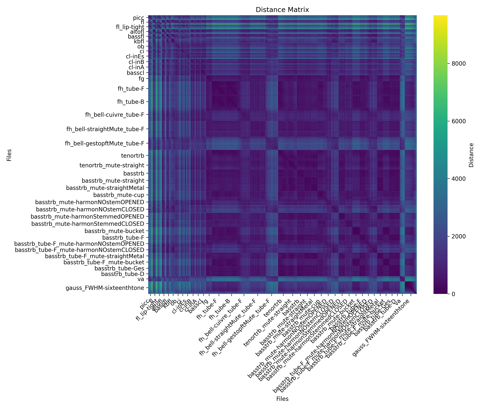
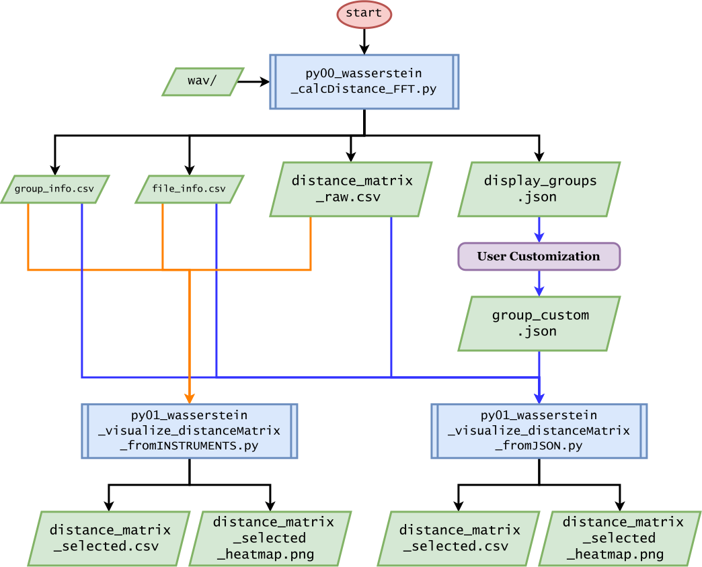

Lingue: | [English](../README.md) | [日本語](../README.md) | [Français](README.fr.md) | [Deutsch](README.de.md) | **Italiano** | [Русский](README.ru.md) |

> *Klangfarbenmelodien! Welche feinen Sinne, die hier unterscheiden, welcher hochentwickelte Geist, der an so subtilen Dingen Vergnügen finden mag!*
>
> *Wer wagt hier Theorie zu fordern!*
>
> — Arnold Schönberg, *Harmonielehre* (1911)

> «Melodie di timbri»! Quali sensi raffinati sono necessari per distinguere queste differenze! Quale spirito altamente sviluppato può trovare piacere in differenze sonore tanto sottili!
>
> Chi oserebbe esigere qui una nuova teoria?
>
> — A. Schönberg, *Harmonielehre* (1911)

Il compositore **A. Schönberg** scrisse queste parole alla fine della sua *Harmonielehre* (1911), pubblicata anche nel contesto del lutto per la morte di **G. Mahler**, compositore e direttore d'orchestra che era stato per lui un maestro e un amico.

A questa sfida si confrontarono direttamente **A. Berg** e **A. Webern** e, dopo la Seconda guerra mondiale, anche **L. Nono**, **P. Boulez** e **K. Stockhausen**. Eppure, nel corso delle loro vite, nessuno di loro riuscì a costruire un metodo pienamente adeguato. Loro, e forse la musica stessa, erano arrivati troppo presto rispetto alla storia della scienza.

Nel XXI secolo, grazie al metodo della **geometria dell'informazione** sviluppato da **Shun-ichi Amari** (dal 1982–1985 in poi), possiamo misurare la «distanza tra timbri» come una quantità precisa, espressa in Hz. Da qui diventano possibili le «geodetiche del timbro», una «geometria degli accordi e dell'armonia» e, infine, una **teoria dell'armonia dei timbri** (*Klangfarbenharmonie*), concepita da Schönberg al di là dell'armonia convenzionale basata sulle altezze. Sviluppiamo qui queste idee, con l'intento di aprire una nuova porta nella storia della musica.

# Atlas Enharmonic Spectra — Atlante degli spettri enarmonici

*«Klangfarbenharmonie» — Un invito all'accordatura spettrale per ensemble armonici.*

*«Armonia dei timbri» — L'accordatura degli spettri per armonizzare un ensemble.*

---

**Atlas Enharmonic Spectra** è un dataset cromatico di note lunghe strumentali e vocali, insieme a un sistema di strumenti di calcolo basati sulla geometria dell'informazione musicale, sviluppato per lo studio di **Klangfarbenharmonie** e **Klangfarbenakkord**, due concetti volti a far progredire in modo sostanziale la costruzione del timbro negli ensemble.

Oltre a registrazioni standardizzate che coprono l'intera estensione pratica dei diversi strumenti, il repository comprende script per l'estrazione degli spettri mediante FFT, il calcolo dell'entropia di Shannon intrinseca degli spettri normalizzati, il calcolo delle distanze di Wasserstein e le relative matrici delle distanze. Il repository costituisce la base per descrivere le relazioni timbriche attraverso il trasporto ottimo tra spettri normalizzati, introdotto per la prima volta in [*Klangfarbenakkord and Klangfarbenharmonien: Metric Space Models for Music on Informational Geometry 1*](https://arxiv.org/abs/2608.28026).

È uno strumento di supporto alla composizione, all'arrangiamento e all'esecuzione, che permette di confrontare e valutare i timbri attraverso differenze di altezza, strumento e tecnica esecutiva.



## ✨ Caratteristiche

- **43 categorie di strumenti** (legni, ottoni, archi, segnali di riferimento e altro; il dataset verrà ampliato progressivamente).
- **2655 registrazioni WAV** di note lunghe cromatiche (il dataset verrà ampliato progressivamente).
  - Frequenza di campionamento: \(f_s=96\ \mathrm{kHz}\).
  - Numero di campioni: \(N=2^{20}\).
  - Di conseguenza, la durata dei dati è uniformata a \(N/f_s=10.922666\ldots\ \mathrm{sec}\).
  - Si veda [*Sparse FFT: nuova analisi in frequenza ad alta risoluzione e sue applicazioni*](https://jastice.org/2022/05/16/vol-8-2-pp-188-193-2021-2022/).
- Convenzione uniforme di denominazione dei file, comprendente altezza scritta, altezza reale e condizioni esecutive.
- Script per il calcolo delle distanze di Wasserstein L1 e L2 tra spettri.
- Matrici delle distanze di Wasserstein precalcolate.

## 📁 Struttura del repository

```text
atlas-enharmonic-spectra/
├── wav/
│   ├── fl/          # Flauto
│   ├── ob/          # Oboe
│   ├── cl-inEs/     # Clarinetto in Mi♭
│   ├── cl-inB/      # Clarinetto in Si♭
│   ├── basscl/      # Clarinetto basso
│   ├── va/          # Viola
│   └── ...          # Altri strumenti
│
├── distanceMatrix_L1/    # Matrice delle distanze di Wasserstein L1 precalcolata
├── distanceMatrix_L2/    # Matrice delle distanze di Wasserstein L2 precalcolata
├── py00_wasserstein_calcDistance_FFT.py
└── py01_wasserstein_visualize_distanceMatrix_*.py
```

Ogni directory degli strumenti contiene registrazioni di note lunghe su tutta la scala cromatica. Per alcuni strumenti sono incluse anche varianti relative a diteggiature alternative, sordine e altre condizioni esecutive.

## 🏷️ Convenzioni di denominazione dei file

Esempi:

```text
fl012_C5.wav
altofl018_conc-Cis5_writ-Fis5.wav
basstrb045_F4_ovt-06_pos-I.wav
```

A seconda dello strumento, il nome del file può includere le seguenti informazioni:

- Altezza reale (`conc-*`)
- Altezza scritta in partitura (`writ-*`)
- Numero dell'armonico (`ovt-*`)
- Posizione o diteggiatura (`pos-*`)
- Tipo di sordina (`mute-*`)
- Condizioni esecutive

## ▶️ Procedura di esecuzione

Eseguire i programmi Python seguendo il diagramma di flusso riportato di seguito. A seconda delle esigenze, verranno generate matrici delle distanze di Wasserstein in formato CSV e visualizzazioni a mappa di colori in formato PNG.



## 🎼 Contesto della ricerca

Nella sua *Harmonielehre* (1911), Arnold Schönberg scrisse che sarebbe stato possibile:

> *«...produrre successioni le cui relazioni reciproche agissero secondo una sorta di logica, del tutto equivalente a quella che ci basta nella melodia delle altezze sonore.»*

Allo stesso tempo, riconosceva che tale possibilità apparteneva ancora al futuro:

> *«Ciò sembra una fantasia del futuro, e probabilmente lo è. Ma è una fantasia nella cui realizzazione credo fermamente.»*

Questa **fantasia del futuro** è stata successivamente raccolta e sviluppata da numerosi compositori, tra cui **Webern**, **Messiaen**, **Nono**, **Boulez** e **Stockhausen**. In particolare, il serialismo del dopoguerra estese l'organizzazione musicale oltre le altezze, includendo anche durate, dinamiche e timbri. Tuttavia, nella pratica musicale non si è mai consolidato pienamente un metodo capace di trattare trasversalmente i timbri secondo principi comuni analoghi a quelli applicati alle altezze.

Questa differenza riflette il diverso sviluppo storico delle teorie dell'altezza e del timbro. Per le altezze, già in epoche in cui musica e matematica non erano separate come lo sono oggi, si svilupparono sistemi per esprimere le relazioni sonore mediante numeri: dai rapporti di frequenza associati a **Pitagora**, al temperamento giusto di **G. Zarlino**, fino alla derivazione matematica del temperamento equabile a dodici toni di **Zhu Zaiyu**. Questi sistemi di accordatura, tuttavia, definiscono le relazioni tra altezze e non descrivono secondo gli stessi principi né le differenze timbriche tra strumenti né le variazioni continue del timbro durante l'esecuzione. Di conseguenza, mentre per le altezze è stato sviluppato un sistema preciso, al timbro non è mai stata attribuita una scala trasversale equivalente.

Descriviamo lo spazio dei timbri considerando come oggetto primario non il singolo spettro, bensì le distanze tra spettri. In questo modo, quantifichiamo la **Klangfarbenmelodie**, la «melodia dei timbri» concepita da Schönberg, e ne estendiamo l'idea alla **Klangfarbenharmonie**, l'«armonia dei timbri». Confrontando secondo una scala comune la fusione e la divergenza timbrica all'interno di un ensemble, intendiamo fornire una base quantitativa per supportare le decisioni esecutive, di arrangiamento e di composizione.

---

L'analisi non utilizza valutazioni cognitive né questionari soggettivi: considera esclusivamente **grandezze fisicamente osservabili**, fino al punto immediatamente precedente alla loro conversione in quantità percettive legate all'ascolto. Ogni registrazione viene scomposta in uno spettro di frequenza, che viene poi normalizzato e interpretato come una funzione di densità di probabilità, in analogia con l'interpretazione probabilistica di Born. Il modello si ispira al meccanismo fisiologico mediante il quale la coclea scompone spazialmente le componenti in frequenza e le cellule ciliate della membrana basilare le rilevano. Per garantire riproducibilità ed evitare scelte arbitrarie nella scomposizione, utilizziamo la trasformata di Fourier veloce (*Fast Fourier Transform*, FFT).

Negli ultimi anni, la **geometria di Wasserstein** è stata ampiamente utilizzata nell'ambito della geometria dell'informazione, della statistica e dell'apprendimento automatico come struttura geometrica per le distribuzioni di probabilità basata sul trasporto ottimo. In particolare, le ricerche di **Shun-ichi Amari** e di altri studiosi hanno contribuito a esplorare i punti di contatto tra trasporto ottimo e geometria dell'informazione, aprendo nuove prospettive per lo studio geometrico delle distribuzioni di probabilità. Questo repository applica tale quadro all'analisi del timbro, descrivendo la trasformazione timbrica come il «costo minimo di trasporto necessario per trasferire la massa spettrale da una distribuzione spettrale a un'altra».

Per distribuzioni di probabilità unidimensionali $P,Q$, la distanza di Wasserstein di ordine $p$ ($p\ge 1$) si può scrivere, usando le inverse generalizzate (funzioni quantile) ${F_P}^{-1},{F_Q}^{-1}$ delle funzioni di ripartizione $F_P,F_Q$, come

$$\mathcal W_p(P,Q)=\left(\int_{0}^{1}\Bigl\lvert F_P^{-1}(u)-F_Q^{-1}(u)\Bigr\rvert^p\ \mathrm du\right)^{1/p}.$$

In particolare, per $p=1$ si calcola a partire dalla differenza delle funzioni di ripartizione:

$$\mathcal W_1(P,Q)=\int_{-\infty}^{\infty}\Bigl\lvert F_P(x)-F_Q(x)\Bigr\rvert\ \mathrm dx.$$

Qui $F_P,F_Q$ sono rispettivamente le funzioni di ripartizione degli spettri normalizzati $P,Q$:

$$F_P(x) = \int_{-\infty}^x P(y)\ \mathrm dy,\qquad F_Q(x) = \int_{-\infty}^x Q(y)\ \mathrm dy.$$

**Atlas Enharmonic Spectra** tratta spettri discreti ottenuti tramite FFT; le funzioni di ripartizione vengono quindi calcolate come

$$F_P[i]=\sum_{j=0}^{i}{P[j]},\qquad F_Q[i]=\sum_{j=0}^{i}{Q[j]}$$

```python
cdf_P = np.cumsum(spectrum_P)
cdf_Q = np.cumsum(spectrum_Q)
```

e la distanza di Wasserstein $L^1$ ($p=1$) tra le sequenze di dati discrete viene calcolata come

$$\mathcal W_1(P,Q)=\sum_i{\Bigl\lvert F_P[i]-F_Q[i]\Bigr\rvert\ \Delta f}$$

```python
return np.sum(np.abs(cdf_P - cdf_Q)) * df
```

dove $\Delta f$ (`df`) è la risoluzione in frequenza della FFT:

$$
\Delta f = \frac{f_{\text s}}{N} \approx 0.092\ \mathrm{Hz}.
$$

Questa formulazione permette di misurare «quanta massa spettrale deve essere spostata e di quanto», mantenendo invariata la probabilità spettrale totale. La differenza timbrica viene così rappresentata non attraverso le differenze tra singoli picchi, ma come il lavoro minimo necessario per riallocare l'intero spettro.

Da questo quadro derivano i modelli di spazio metrico per **Klangfarbenakkord** e **Klangfarbenharmonie**. Collocando i timbri strumentali in uno spazio metrico comune, intendiamo quantificare la fusione e la divergenza timbrica nell'orchestrazione e sostenere le pratiche compositive di **Klangfarbenharmonie**, come sviluppo della **Klangfarbenmelodie**.

Questo repository mira a fornire una base per confrontare i timbri mediante una scala comune fondata su grandezze fisiche, favorendo la pratica della Klangfarbenmelodie e della Klangfarbenharmonie, nonché le applicazioni alla progettazione degli ensemble e all'orchestrazione.

## 📖 Citazione

Se si utilizza questo dataset, si prega di citare il relativo articolo.

```bibtex
@misc{tamura2026klangfarbenakkord,
  title={Klangfarbenakkord and Klangfarbenharmonien: Metric Space Models for Music on Informational Geometry 1},
  author={Yusei Tamura and Shigekazu Ishihara and Ken Ito},
  year={2026},
  eprint={2608.28026},
  archivePrefix={arXiv},
  primaryClass={cs.SD}
}
```

Articolo: [*Klangfarbenakkord and Klangfarbenharmonien: Metric Space Models for Music on Informational Geometry 1*](https://arxiv.org/abs/2608.28026)

## 📖 Riferimenti bibliografici

1. Arnold Schönberg. *Harmonielehre*. Universal Edition, Vienna (1911).
2. Shun-ichi Amari. Differential geometry of curved exponential families—curvatures and information loss. *The Annals of Statistics* **10**(2), pp. 357–385 (1982).
3. Shun-ichi Amari. *Differential-geometrical methods in statistics* (Lecture Notes in Statistics, **28**). Springer-Verlag (1985).
4. Li Jinyoung e Ken Ito. *Sparse FFT: nuova analisi in frequenza ad alta risoluzione e sue applicazioni*. *JASTICE* **8**(2), pp. 188–193 (2021/2022). [Articolo](https://jastice.org/2022/05/16/vol-8-2-pp-188-193-2021-2022/).
5. Yusei Tamura, Shigekazu Ishihara e Ken Ito. *Klangfarbenakkord and Klangfarbenharmonien: Metric Space Models for Music on Informational Geometry 1*. *arXiv*, arXiv:2608.28026 (2026). [Articolo](https://arxiv.org/abs/2608.28026).